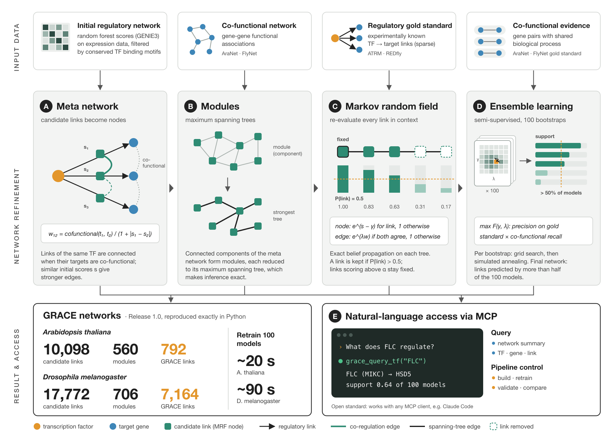

<h1 align="center">GRACE</h1>
<p align="center"><b>Gene Regulatory network inference ACcuracy Enhancement</b><br/>
Markov random fields that integrate regulatory and co-functional evidence to refine gene regulatory networks</p>

<p align="center">
  
</p>

GRACE refines an initial gene regulatory network (random forest scores filtered by conserved TF binding
motifs) by re-evaluating every candidate link in the context of functionally related links. Candidate links
become nodes of a meta network; links of the same transcription factor are connected when their targets are
co-functional. Each connected module is reduced to its maximum spanning tree and solved exactly as a Markov
random field. The model is trained semi-supervised on a sparse regulatory gold standard and on co-functional
gene pairs, and the final network is the ensemble of 100 bootstrap models.

This is the Python implementation of [Banf & Rhee, *Scientific Reports* 7:41174 (2017)](https://www.nature.com/articles/srep41174),
with an MCP server for exploring the networks in natural language. It reproduces the published results
exactly; the original R code is on the [`release/1.0`](https://github.com/mbanf/GRACE/tree/release/1.0) branch.

## Installation

```bash
git clone https://github.com/mbanf/GRACE.git
cd GRACE
uv sync --extra mcp          # or: pip install -e ".[mcp]"
```

Requires Python ≥ 3.10. Download the tutorial datasets (see [Data](#data)), unpack them into one folder
(giving `athaliana_datasets/` and `drosophila_datasets/`) and point GRACE at it:

```bash
export GRACE_DATA_DIR=/path/to/datasets
```

## Quick start

```bash
# rebuild the published networks from the published models (seconds)
python -m grace reproduce

# retrain 100 models from scratch and build the ensemble network
python -m grace train athaliana            # ~20 s on 12 cores
python -m grace train drosophila           # ~90 s on 12 cores

# enrichment of a network for independent evidence (ChIP, AtRegNet, co-localization, Hi-C, ...)
python -m grace validate drosophila
python -m grace validate athaliana --network results/network_athaliana.csv
```

`train` uses all cores but two by default (`--workers N` to change). `--seed-offset 0` uses the seeds of
the original R tutorials; other offsets give independent reruns.

From Python:

```python
from grace.pipeline import prepare, ensemble_network
from grace.reference import published_models
from grace.train import train_models

p = prepare("athaliana", "/path/to/datasets")
published = ensemble_network(p, published_models("athaliana"))   # 792 links, as published
models = train_models(p.training, n_models=100)                   # retrain
retrained = ensemble_network(p, models)                           # TF, TG, score, support
```

## MCP server: natural-language access

The repository ships a `.mcp.json`, so Claude Code picks up the server when you open the project; it reads
the data folder from `GRACE_DATA_DIR`. Any other MCP client can start it with:

```bash
python -m grace_mcp --data-dir /path/to/datasets
```

Then ask, for example:

- *"What does FLC regulate in the GRACE network?"*
- *"Why is the FLC → HSD5 link in the network? Show its module and evidence."*
- *"Retrain the Drosophila model with new seeds and compare it with the published network."*
- *"Which links survive if I require support from 70% of the models?"*
- *"How enriched is the Drosophila network for ChIP binding and Hi-C contacts?"*

| Tool | Description |
|------|-------------|
| `grace_summary` | Inputs, modules, gold standards and stored networks per species |
| `grace_query_tf` | Targets of a TF, with ensemble support and gold-standard hits (A. thaliana gene symbols work) |
| `grace_query_gene` | Regulators of a target gene |
| `grace_query_link` | One link: initial score, module, spanning-tree neighbours, support, evidence |
| `grace_build_network` | Ensemble network from a model set at any support threshold |
| `grace_train` | Retrain 100 models from scratch and store the network |
| `grace_validate` | Fold enrichment and hypergeometric p for regulatory and co-functional evidence |
| `grace_compare` | Shared and unique links between two networks, TFs that changed most |

## Validation

The Python implementation reproduces the R implementation step by step:

| Check | *A. thaliana* | *D. melanogaster* |
|---|---|---|
| Dataset loading: GRN scores, co-functional network, gold standards, validation sets | identical | identical |
| Meta network: links, co-regulation edges, modules, spanning trees | 10,098 · 7,312 · 560 · 1,995 identical | 17,772 · 34,066 · 706 · 7,457 identical |
| Markov random field inference, per model and ensemble | identical | identical |
| Published models → published network | 792 / 792 links | 7,164 / 7,164 links |
| Retraining from scratch vs published network (Jaccard) | 0.965 | 0.992 |
| Retraining vs a rerun with other seeds (Jaccard) | 0.997 | 0.994 |

Training uses `scipy.optimize.dual_annealing`, the same generalized simulated annealing as R's `GenSA`, so
retrained networks agree closely with the published ones but not bit for bit. Inference is exact belief
propagation compiled with Numba, about 400× faster than the R implementation.

```bash
pytest                                  # core tests run without data
GRACE_DATA_DIR=/path/to/datasets pytest # plus reproduction and MCP tests
```

## Package structure

```
grace/
├── datasets.py      # tutorial dataset loading (A. thaliana, D. melanogaster), incl. R .rds files
├── network.py       # meta network, modules, maximum spanning trees
├── mrf.py           # Markov random field: exact tree belief propagation with clamping (Numba)
├── train.py         # bootstrap sampling, grid search, simulated annealing, ensemble
├── pipeline.py      # end-to-end setup and ensemble network
├── validation.py    # enrichment for regulatory and co-functional evidence
├── reference.py     # published model weights and networks (grace/reference/)
└── __main__.py      # command line: reproduce, train, validate
grace_mcp/
└── server.py        # MCP server (8 tools)
```

## Data

The tutorial datasets are not stored in this repository:
[GRACE tutorial datasets (OneDrive)](ONEDRIVE_LINK_TBD).

| Species | Initial network | Co-functional network | Regulatory gold standard | Validation |
|---|---|---|---|---|
| *A. thaliana* | GENIE3 + conserved motifs (development) | AraNet v2 | ATRM | AtRegNet, SUBA3 co-localization, AraCyc (optional) |
| *D. melanogaster* | GENIE3 + motifs (Marbach *et al.* 2012) | FlyNet | REDfly | ChIP binding, ImaGO tissue co-localization, Hi-C |

The AraCyc pathway file (`aracyc-12.0.1-pathways.20150407`, from the Plant Metabolic Network) is optional.

## Branches

| Branch | Description |
|--------|-------------|
| `master` | Python implementation + MCP server (recommended) |
| `release/1.0` | Original R implementation with the published results |

## Talk

[](https://www.youtube.com/watch?v=sQ02p4CU6UM "GRACE")

## Reference

Banf M, Rhee SY. Enhancing gene regulatory network inference through data integration with Markov random
fields. *Scientific Reports* 7:41174 (2017). https://www.nature.com/articles/srep41174

The *D. melanogaster* model uses data from Marbach D, *et al.* Predictive regulatory models in *Drosophila
melanogaster* by integrative inference of transcriptional networks. *Genome Res.* 22(7):1334-49 (2012).

## License

MIT License. Contact: [Michael Banf](mailto:michael@junkdna.ai)
