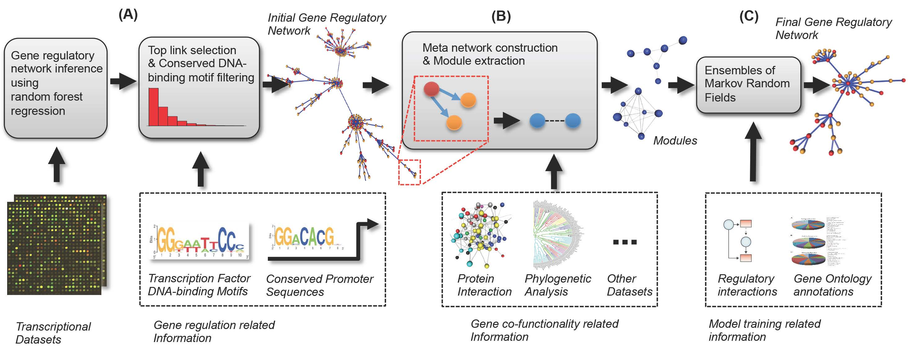

# GRACE — Release 1.0 (original R implementation)

**Enhancing gene regulatory network inference through data integration with Markov random fields**

This branch holds the original R implementation of GRACE and the published results of
[Banf & Rhee, *Scientific Reports* 7:41174 (2017)](https://www.nature.com/articles/srep41174).
For the Python implementation with an MCP server, see the [`master`](https://github.com/mbanf/GRACE) branch.

<p align="center">
  
</p>

## About

A gene regulatory network links transcription factors to their target genes and represents a map of
transcriptional regulation. GRACE (Gene Regulatory network inference ACcuracy Enhancement) exploits
biological *a priori* knowledge and heterogeneous data integration to generate high-confidence network
predictions for eukaryotic organisms, using Markov random fields in a semi-supervised fashion. It is
particularly suited for model learning with sparse regulatory gold-standard data. The paper shows
GRACE's results on *Drosophila melanogaster* and *Arabidopsis thaliana* data; in an *A. thaliana*
developmental network, GRACE recovers cell-cycle-related regulatory mechanisms and proposes novel
regulatory links.

## Running the tutorials

Tested with R 4.4 (the code was written for R 3.2).

1. Install the R packages:

   ```r
   install.packages(c("Matrix", "reshape2", "ggplot2", "ROCR", "caTools", "plyr", "foreach",
                      "doParallel", "igraph", "GenSA", "ranger"))
   # CRF was archived on CRAN; install the last release from the archive
   install.packages("https://cran.r-project.org/src/contrib/Archive/CRF/CRF_0.4-3.tar.gz",
                    repos = NULL, type = "source")
   ```

2. Download the tutorial datasets (see [Data](#data)) and unpack them, giving folders
   `athaliana_datasets/` and `drosophila_datasets/`.

3. Run a tutorial:

   ```bash
   ./run_tutorial.sh athaliana  /path/to/datasets
   ./run_tutorial.sh drosophila /path/to/datasets
   ```

   The script builds a flat working folder `work/` (the tutorials source all files from their working
   directory) and writes `prediction_<species>_graceEnsemble.csv` there.

By default the tutorials load the precomputed models from the paper and rebuild the ensemble network.
Both runs reproduce the published networks exactly:

| Tutorial | Runtime | Result |
|---|---|---|
| *A. thaliana* | ~40 s | 792 links, identical to `prediction_arabidopsis_graceEnsemble.csv` |
| *D. melanogaster* | ~3.5 min | 7,164 links, identical to `prediction_drosophila_graceEnsemble.csv` |

To retrain the 100 models instead of loading them, switch the `if(FALSE)` block around model training
in the tutorial to `if(TRUE)` (about 42 s per model for *A. thaliana* and 186 s for *D. melanogaster*
on one core).

### Changes from the 2017 code

Only what is needed to run on current R:

- `netbenchmark` is no longer loaded: it was removed from Bioconductor and was never called.
- The hard-coded `setwd()` in the tutorials is removed; `run_tutorial.sh` sets up the working folder.
- The AraCyc pathway file (`aracyc-12.0.1-pathways.20150407`, from the Plant Metabolic Network) is
  optional. It is only used to validate co-regulated gene pairs, not for training or prediction. Without
  it, the AraCyc validation column reads 0.

## Repository layout

```
R/                        GRACE core: meta network, modules, Markov random fields, optimization
tutorials/                A. thaliana and D. melanogaster tutorials, dataset loading, evaluation
man/                      function documentation
run_tutorial.sh           runs a tutorial on current R
prediction_*_graceEnsemble.csv   published GRACE networks
```

## General usage

1. Initial gene regulatory network inference (Figure 1A) with fast random forest regression, followed
   by DNA-binding motif filtering (`tutorials/GRACE_initial_GRN_inference.R`).
2. Configure `R/GRACE_load_datasets.R` with the paths to all datasets.
3. Configure `tutorials/GRACE_pipeline_template.R` as described in the script, to run GRACE on the
   initial network with co-functional network information, and regulatory and co-functional evidence
   as training sets (Figure 1B-C).

## Data

The tutorial datasets are not stored in this repository. Download them here:
[GRACE tutorial datasets (OneDrive)](https://1drv.ms/f/c/6346f45e78d9bcf9/IgAgxW1n0wl0T5G_wxs18KpgATjpFUQECF1bKNYVJrAsM8g?e=HuSa5e).

The *D. melanogaster* model uses data from Marbach D, *et al.* Predictive regulatory models in
*Drosophila melanogaster* by integrative inference of transcriptional networks. *Genome Res.*
22(7):1334-49 (2012).

## Talk

[](https://www.youtube.com/watch?v=sQ02p4CU6UM "GRACE")

## Reference

Banf M, Rhee SY. Enhancing gene regulatory network inference through data integration with Markov
random fields. *Scientific Reports* 7:41174 (2017). https://www.nature.com/articles/srep41174

## License

MIT License. Contact: [Michael Banf](mailto:michael@junkdna.ai)
